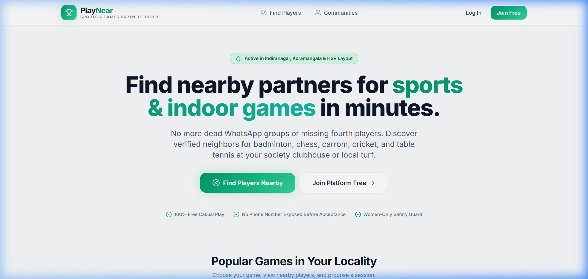
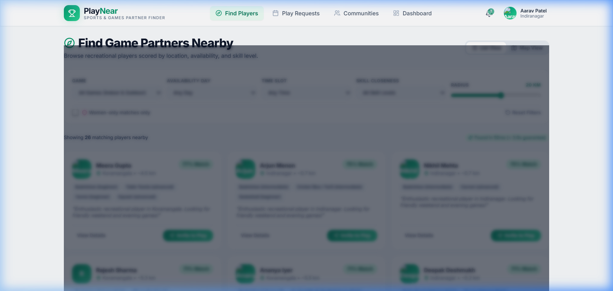
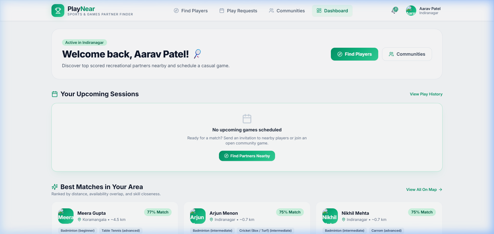
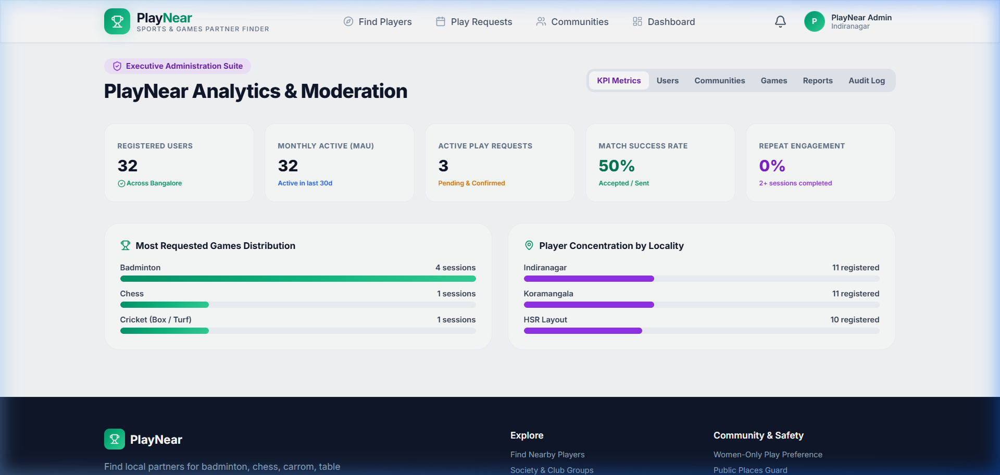
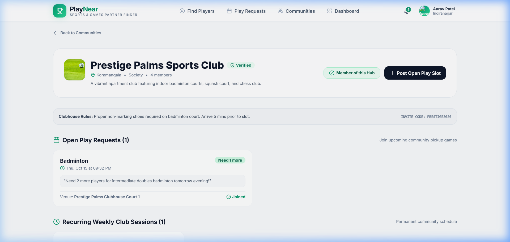

# PlayNear 🏸 ♟️ 🏓 🏏

> **Local Sports & Indoor Games Partner Finder Platform**  
> A community platform helping urban residents discover nearby partners for indoor and outdoor games (chess, carrom, cards, badminton, table tennis, box cricket, football) at their residential society clubhouse or local ground.

---

## 📸 Platform Screenshots

| Landing Page | Partner Discovery & Map |
| :---: | :---: |
|  |  |

| Player Dashboard & Matches | Executive Admin KPI Suite |
| :---: | :---: |
|  |  |

| Society Club Sports Hub |
| :---: |
|  |

---

## 🌟 Highlights & Solved Problems

- **No More Chaotic WhatsApp Groups**: Replace informal messaging boards with location-based discovery, one-click play invites, and confirmations.
- **Weighted Compatibility Score (0–100)**:
  - 📍 **Distance (40%)**: Great-circle proximity within 0.5 km to 30 km radius.
  - ⏰ **Availability Overlap (30%)**: Matches morning, afternoon, and evening free slots.
  - 🏆 **Skill Closeness (20%)**: Pairs beginner, intermediate, and advanced players compatibly.
  - 🤝 **Shared Games & Society (10%)**: Mutual sport interests and apartment club membership.
- **Privacy & Safety First**:
  - Exact coordinates are **never** broadcast; coordinates are fuzzed ($\sim 250$m jitter) on public maps.
  - Contact handles (WhatsApp / Phone) are locked and revealed **only after** both players accept.
  - **Women-Only Play Preference**: Female players can restrict searches exclusively to other verified women.
  - **Public Places Guard**: Meet only at community clubhouses or public sports grounds.
- **Double-Booking Protection**: Rejects overlapping requests within a 2-hour window.
- **Automated Expiry Worker**: Runs every 5 minutes to transition stale pending invites to expired.
- **Society & Club Hubs**: Residential societies can schedule recurring sessions and post open play slots ("Need 2 more for badminton today 6 PM").
- **Admin Suite & Analytics**: Tracks 5 primary KPIs (Registered Users, MAU, Active Requests, Match Success Rate, Repeat Engagement Rate).

---

## 🛠️ Technology Stack

- **Frontend**: Next.js 14 (App Router), React 18, Tailwind CSS, Lucide Icons, Glassmorphism Design System.
- **Maps & Geospatial**: Leaflet + OpenStreetMap (100% free, zero paid API key needed), Nominatim geocoding.
- **Backend API**: Node.js, Express.js REST API (prefix `/api/v1`), Zod validation, JWT in `httpOnly` cookies, bcrypt password hashing.
- **Database**: MongoDB (Mongoose) with **2dsphere geospatial index** on `playnear_platform_db`. Automatic in-memory fallback for zero-config local testing.
- **Security**: Helmet security headers, CORS whitelist, NoSQL injection sanitization (`mongoSanitize`), rate limiting on auth and search routes.
- **API Documentation**: Interactive Swagger UI at `/api/docs`.
- **Testing**: Jest + Supertest (Backend unit and integration tests), E2E browser automation.
- **Deployment**: Docker, Docker Compose, Vercel (Frontend), Render / AWS (Backend), MongoDB Atlas.

---

## 🔑 Demo Accounts & Credentials

The platform is pre-seeded with 30 realistic demo players across 3 Bangalore hubs (**Indiranagar**, **Koramangala**, **HSR Layout**):

| Role | Email | Password | Permissions / Highlights |
|---|---|---|---|
| **Admin** | `admin@playnear.com` | `AdminPass123!` | Full admin KPIs, user moderation, community verification, audit log |
| **Organizer** | `organizer@playnear.com` | `OrgPass123!` | Manages Prestige Palms Sports Club, posts pickup games |
| **Player (Aarav)** | `user1@playnear.com` | `UserPass123!` | Indiranagar, Badminton & Cricket, 77% match scores |
| **Player (Ananya)** | `user2@playnear.com` | `UserPass123!` | Koramangala, Chess & Table Tennis |
| **Players (3–30)** | `user3@playnear.com` to `user30@playnear.com` | `UserPass123!` | Mixed skill levels, genders, and weekly availability |

*(Note: The login page includes convenient **One-Click Demo Credentials** buttons to instantly fill credentials).*

---

## 🚀 Quick Start (Local Setup)

### Option A: Using NPM Scripts (Recommended)

1. **Clone and Install**:
   ```bash
   git clone <repo-url>
   cd PlayNear
   npm install
   cd server && npm install
   cd ../client && npm install
   cd ..
   ```

2. **Configure Environment**:
   ```bash
   # In root or server:
   cp .env.example server/.env
   # Ensure database is playnear_platform_db
   ```

3. **Seed Database**:
   ```bash
   npm run seed
   ```
   *(Seeds 10 sports, 30 demo users, 3 communities, and sample requests).*

4. **Start Both Client and Server**:
   ```bash
   # From root directory:
   npm run dev
   # Or run individually:
   # Terminal 1: npm run dev:server (Port 5000)
   # Terminal 2: npm run dev:client (Port 3000)
   ```

5. **Open Applications**:
   - **Frontend Web App**: [http://localhost:3000](http://localhost:3000)
   - **Backend REST API**: [http://localhost:5000/api/v1](http://localhost:5000/api/v1)
   - **Interactive API Swagger Docs**: [http://localhost:5000/api/docs](http://localhost:5000/api/docs)
   - **Health Endpoint**: [http://localhost:5000/api/health](http://localhost:5000/api/health)

---

### Option B: Using Docker Compose (One-Command Run)

```bash
docker compose up --build
```

Spins up:
- Container `playnear-mongo` on port `27017`
- Container `playnear-server` on port `5000`
- Container `playnear-client` on port `3000`

---

## 🧪 Testing Summary

The test suite covers integration tests across the entire backend API:

```bash
npm run test:server
```

### Test Results (100% Passing):
- `test/auth.test.ts`: Registration, duplicate validation, password hashing, JWT cookies, profile updates.
- `test/search.test.ts`: Geospatial queries, matching scores (0-100), execution time $< 3000$ms, privacy fuzzing.
- `test/request.test.ts`: Play request state machine, double-booking rejection ($409$ Conflict), auto-expiry, contact reveal on acceptance.
- `test/admin.test.ts`: KPI analytics aggregation, user suspension/reactivation, platform audit logs.

**Total Suites**: 4 passed, 4 total  
**Total Tests**: 22 passed, 22 total  
**Execution Timing**: Well under 3 seconds per search request.

---

## 📁 Repository Structure

```
PlayNear/
├── client/                     # Next.js 14 App Router Frontend
│   ├── src/
│   │   ├── app/                # Pages: find, dashboard, requests, history, communities, admin
│   │   ├── components/         # Navbar, MobileNav, LeafletMap, Modals, Footer
│   │   ├── context/            # AuthContext, ToastContext
│   │   └── lib/                # apiFetch client
│   ├── Dockerfile
│   └── tailwind.config.ts      # Sports design system tokens
│
├── server/                     # Express.js REST API
│   ├── src/
│   │   ├── config/             # MongoDB connection (with in-memory fallback)
│   │   ├── controllers/        # auth, user, game, search, request, community, admin
│   │   ├── middleware/         # auth (JWT), mongoSanitize, errorHandler
│   │   ├── models/             # Mongoose schemas: User, Game, PlayRequest, Community, etc.
│   │   ├── routes/             # REST endpoints (/api/v1/*)
│   │   ├── services/           # matchingService (0-100 weighted formula)
│   │   ├── utils/              # mailer, token
│   │   ├── docs/               # OpenAPI / Swagger specification
│   │   ├── seed.ts             # 30 demo users, 10 games, 3 communities seed script
│   │   └── index.ts            # App entry point with auto-expiry background worker
│   ├── test/                   # Jest + Supertest integration tests
│   └── Dockerfile
│
├── docs/                       # Project Documentation
│   ├── PRD.md                  # Complete Product Requirements Document
│   ├── TECHNICAL.md            # Architecture diagrams, data models, security
│   ├── DEPLOYMENT.md           # Deployment steps for Vercel, Render, Atlas
│   ├── DECISIONS.md            # Engineering trade-offs & design decisions
│   └── screenshots/            # Verified application walkthrough screenshots
│
├── docker-compose.yml          # Multi-container local orchestration
├── .env.example                # Environment variables template
└── package.json                # Root orchestration scripts
```

---

## 🔮 Future Scope (Roadmap)
- **Mobile Native Applications**: React Native / Flutter wrappers for push notifications and GPS tracking.
- **In-App Messaging & Calling**: WebRTC-based audio/chat post-acceptance.
- **Tournaments & Community Ladders**: Elo scoring and society seasonal championships.
- **AI-Based Partner Recommendations**: Machine learning recommendations augmenting the modular `matchingService.ts`.

---

## 📄 License
MIT © PlayNear Team. Built for healthy, active neighborhood recreation.
