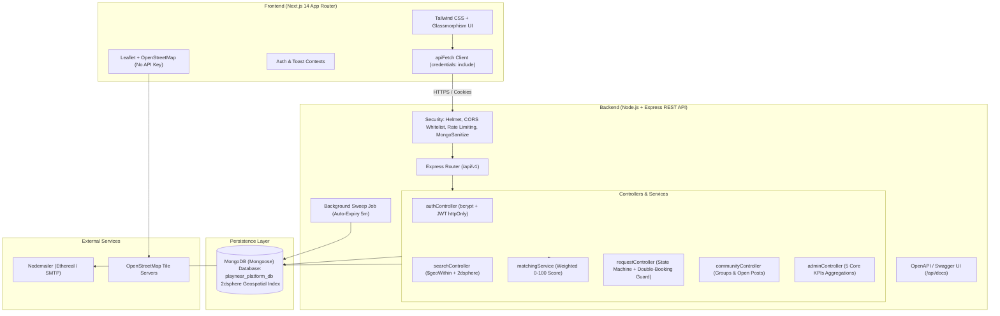
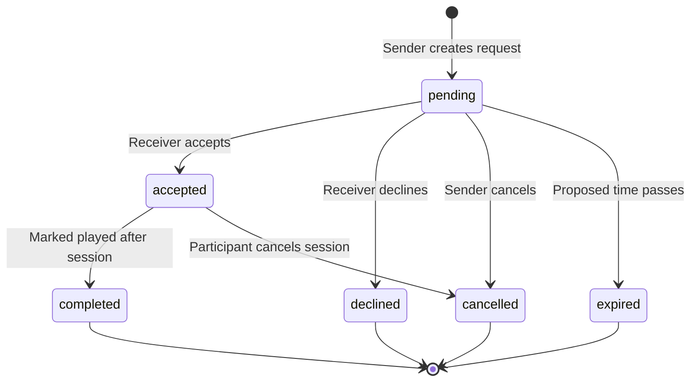

# PlayNear - Technical Architecture & Engineering Documentation

This document describes the end-to-end technical architecture, database schemas, security posture, API contracts, and deployment topology of **PlayNear** (Local Sports & Indoor Games Partner Finder Platform).

---

## 1. High-Level System Architecture



---

## 2. Data Models (Mongoose Schemas)

### User Schema (`User.ts`)
- `name`: String (required, trimmed)
- `email`: String (unique, lowercase, indexed)
- `passwordHash`: String (bcrypt, salt rounds 10)
- `role`: Enum `['user', 'organizer', 'admin']` (default `'user'`)
- `gender`: Enum `['male', 'female', 'non-binary', 'prefer-not-to-say', 'other']`
- `ageGroup`: Enum `['18-24', '25-34', '35-44', '45-54', '55+']`
- `photo`: String (URL)
- `bio`: String (max 500 chars)
- `locality`: String (indexed)
- `location`: GeoJSON Point `{ type: 'Point', coordinates: [lng, lat] }` with **2dsphere index**
- `contactPreference`: Enum `['whatsapp', 'phone', 'email']`
- `contactValue`: String (strictly masked from public views; revealed only on accepted sessions)
- `playingLocations`: Array of `['home', 'clubhouse', 'ground']`
- `primaryVenue`: String
- `emailVerified`: Boolean
- `status`: Enum `['active', 'suspended']`
- `womenOnlyPlay`: Boolean (safety toggle)
- `publicPlacesOnly`: Boolean (safety toggle)
- `blockedUsers`: Array of `ObjectId` references to `User`
- `lastActiveAt`: Date (used for MAU calculations)

### Game Schema (`Game.ts`)
- `name`: String (unique, required)
- `category`: Enum `['indoor', 'outdoor']`
- `minPlayers`: Number (default 2)
- `maxPlayers`: Number (default 4)
- `icon`: String (lucide icon identifier)
- `isActive`: Boolean

### UserGamePreference Schema (`UserGamePreference.ts`)
- `user`: ObjectId $\rightarrow$ `User`
- `game`: ObjectId $\rightarrow$ `Game`
- `skillLevel`: Enum `['beginner', 'intermediate', 'advanced']`
- Compound Index: `{ user: 1, game: 1 }` (unique)

### Availability Schema (`Availability.ts`)
- `user`: ObjectId $\rightarrow$ `User`
- `dayOfWeek`: Enum `['monday', 'tuesday', ..., 'sunday']`
- `slots`: Array of `{ slotType: 'morning' | 'afternoon' | 'evening' | 'custom', start: String, end: String }`

### PlayRequest Schema (`PlayRequest.ts`)
- `sender`: ObjectId $\rightarrow$ `User`
- `receiver`: ObjectId $\rightarrow$ `User`
- `game`: ObjectId $\rightarrow$ `Game`
- `proposedDateTime`: Date (required)
- `durationMinutes`: Number (default 60)
- `locationType`: Enum `['home', 'clubhouse', 'ground']`
- `venue`: String
- `message`: String
- `status`: Enum `['pending', 'accepted', 'declined', 'cancelled', 'expired', 'completed']`
- `respondedAt`: Date
- `completedAt`: Date
- `noShowFlags`: Array of `{ reportedBy, reason, reportedAt }`

### Community Schema (`Community.ts`)
- `name`: String, `slug`: String (unique)
- `type`: Enum `['society', 'club', 'neighborhood', 'corporate']`
- `locality`: String
- `description`, `rules`, `logo`: String
- `organizer`: ObjectId $\rightarrow$ `User`
- `members`: Array of `{ user, role, status, joinedAt }`
- `inviteCode`: String (unique 8-char uppercase code)
- `verificationStatus`: Enum `['pending', 'verified', 'rejected']`

---

## 3. Weighted Matching Algorithm Formula

The matching engine (`server/src/services/matchingService.ts`) calculates a compatibility score between 0 and 100:

$$\text{Matching Score} = \text{Distance (40)} + \text{Availability (30)} + \text{Skill (20)} + \text{Shared Games/Hubs (10)}$$

1. **Distance Score (0–40 pts)**:
   $$\text{Score}_{\text{dist}} = \max\left(0, \frac{R_{\max} - d}{R_{\max}} \times 40\right)$$
   Where $d$ is Great-Circle Haversine distance in km, and $R_{\max}$ is the search radius (default 20 km).
2. **Availability Overlap (0–30 pts)**:
   Compares user day/slot schedules. $\ge 3$ overlapping days = 30 pts, 2 days = 22 pts, 1 day = 15 pts, base = 8 pts.
3. **Skill Closeness (0–20 pts)**:
   Same skill level = 20 pts. 1 step diff (e.g. beginner vs intermediate) = 12 pts. 2 steps diff = 5 pts.
4. **Shared Games & Community (0–10 pts)**:
   Mutual game interests ($\ge 2$ shared games = 6 pts) + shared apartment community membership (+4 pts).

---

## 4. Play Request State Machine & Double-Booking Guard



### Double-Booking Guard
Before transitioning a request to `accepted`, the system checks:
```typescript
const conflict = await PlayRequest.findOne({
  _id: { $ne: requestId },
  status: 'accepted',
  proposedDateTime: { $gte: proposedTime - 2h, $lte: proposedTime + 2h },
  $or: [
    { sender: receiverId }, { receiver: receiverId },
    { sender: senderId }, { receiver: senderId }
  ]
});
if (conflict) throw new ConflictError('Overlapping session already scheduled');
```

---

## 5. Security & Privacy Architecture

1. **NoSQL Injection Sanitization**: Custom recursive middleware sanitizes `req.body`, `req.query`, and `req.params`, stripping keys prefixed with `$` or containing `.`.
2. **HTTPOnly Cookie JWT**: Auth token is delivered in `httpOnly`, `sameSite`, `secure` cookies to eliminate XSS token theft.
3. **Location Privacy**: Public search queries fuzz coordinates by $\sim 250$m jitter and report human-friendly approximate distances (e.g. "~1.5 km"). Exact coordinates are never broadcast to public consumers.
4. **Protected Contacts**: Phone numbers and WhatsApp links are stored securely in database fields that are projected out of all public APIs. They are returned only when request status is `accepted` or `completed`, and only to the two verified players.
5. **Rate Limiting**: Express rate limiters protect auth endpoints (100 reqs/15m) and general API endpoints (1000 reqs/15m).
6. **Safety Filters**: Female users can toggle "Women-only play", which automatically excludes male search queries at the MongoDB database query layer.

---

## 6. API Reference Summary

| Method | Endpoint | Description | Auth Required |
|---|---|---|---|
| `POST` | `/api/v1/auth/register` | Create user profile & dispatch email verification | No |
| `POST` | `/api/v1/auth/login` | Validate credentials, issue httpOnly JWT | No |
| `POST` | `/api/v1/auth/logout` | Clear session cookie | No |
| `GET` | `/api/v1/auth/me` | Fetch authenticated user with preferences | Yes |
| `GET` | `/api/v1/users/:id` | Fetch public-safe profile (fuzzed location, hidden contacts) | Optional |
| `PUT` | `/api/v1/users/me` | Update bio, location, safety toggles | Yes |
| `PUT` | `/api/v1/users/me/games` | Update games & skill rating | Yes |
| `PUT` | `/api/v1/users/me/availability` | Update weekly schedule | Yes |
| `POST` | `/api/v1/users/:id/block` | Block / unblock player | Yes |
| `GET` | `/api/v1/games` | List active indoor & outdoor games | No |
| `GET` | `/api/v1/players/search` | Geospatial discovery with 0-100 matching score | Optional |
| `POST` | `/api/v1/requests` | Propose play session | Yes |
| `GET` | `/api/v1/requests` | List sent / received requests | Yes |
| `PATCH` | `/api/v1/requests/:id/accept` | Accept request (with double-booking check) | Yes |
| `PATCH` | `/api/v1/requests/:id/decline` | Decline request | Yes |
| `PATCH` | `/api/v1/requests/:id/cancel` | Cancel request | Yes |
| `PATCH` | `/api/v1/requests/:id/complete` | Record completed match / report no-show | Yes |
| `GET` | `/api/v1/history` | View play history and match records | Yes |
| `GET` | `/api/v1/communities` | List verified society & club hubs | No |
| `POST` | `/api/v1/communities` | Register new society group | Yes |
| `GET` | `/api/v1/communities/:id` | Community hub details & open play feed | No |
| `POST` | `/api/v1/communities/:id/join` | Join community via code or 1-click | Yes |
| `POST` | `/api/v1/communities/:id/open-posts` | Post open play slot ("Need 2 more") | Yes |
| `POST` | `/api/v1/communities/:id/open-posts/:id/join` | RSVP to open play session | Yes |
| `GET` | `/api/v1/admin/kpis` | 5 platform KPIs & analytics distribution | Admin only |
| `GET` | `/api/v1/admin/users` | List, search & moderate users | Admin only |
| `PATCH` | `/api/v1/admin/users/:id/status` | Suspend or reactivate user account | Admin only |
| `GET` | `/api/v1/admin/reports` | Review user complaints | Admin only |
| `GET` | `/api/v1/admin/activity-log` | System audit trail | Admin only |
